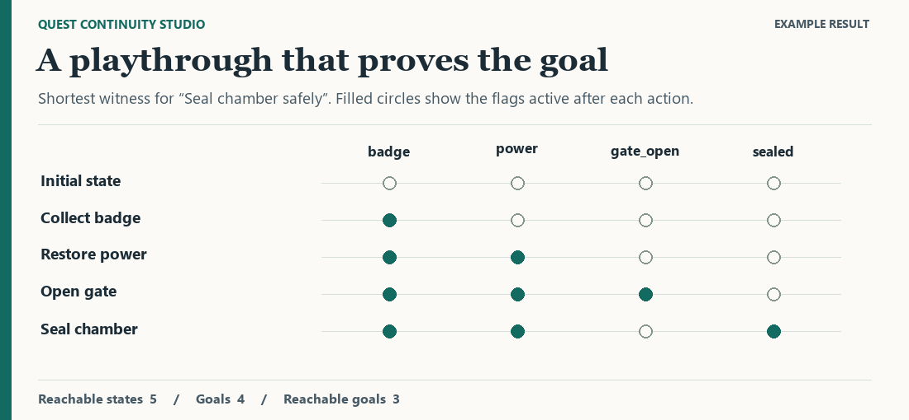
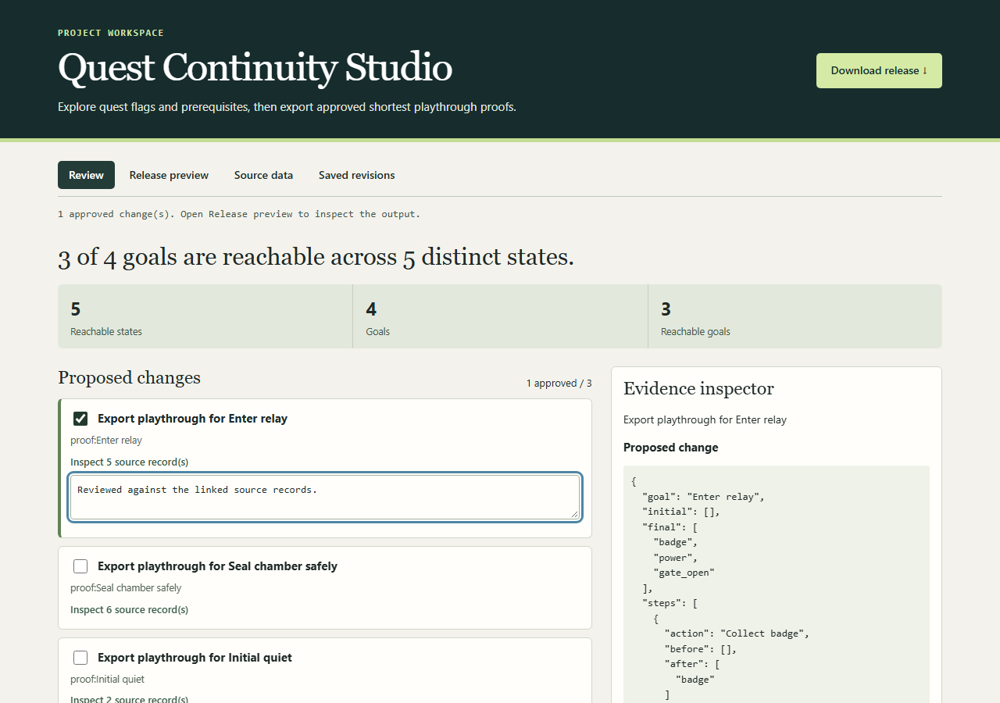

# Quest Continuity Studio

Explore quest flags and prerequisites, then export approved shortest playthrough proofs.

**[Open the live demo](https://oguzhanozfe.github.io/quest-continuity-studio/)** · [](https://github.com/oguzhanozfe/quest-continuity-studio/actions/workflows/check.yml) · [Deploy to Render](https://render.com/deploy?repo=https://github.com/oguzhanozfe/quest-continuity-studio) · [Input guide](GUIDE.md)

Can the player actually finish a branching quest? Replay the shortest sequence of actions that reaches a goal, or inspect the closest reachable state when it is impossible.



The live demo lets you edit the input, search proposed changes with an on-device model and download the result. [Browser demo details](demo/DEMO.md)

## Try it

With Python 3.11+ installed, clone this repository and run:

```sh
git clone https://github.com/oguzhanozfe/quest-continuity-studio.git
cd quest-continuity-studio
python app.py
```

Open <http://127.0.0.1:8000>. The synthetic example is loaded. Select a proposed change, inspect its source records, and open **Release preview** to see the resulting files. Choose **Download release** to save them.

## Walk through the example

Describe a quest as up to twelve named boolean flags, an initial set of flags, repeatable actions and goals. Actions list required and forbidden flags and the flags they set or clear. Goals use the same condition lists. The relay-chamber example includes two achievable objectives, a condition that already holds at the start and a goal requiring two flags that cannot coexist.

**What the engine finds.** 3 of 4 goals are reachable across 5 distinct states.

**Try this decision.** Approve **Export playthrough for Enter relay**. The [example review](docs/example-review.json) lists the supporting record IDs and the checksum of each exported file. Its native outputs are [`playthrough-proofs.json`](docs/example-release/playthrough-proofs.json), [`playthroughs.dot`](docs/example-release/playthroughs.dot).

Reproduce that release at the command line:

```sh
python app.py analyze example.json
python app.py export example.json --approve "proof:Enter relay" --out reviewed.zip
```

## Model-assisted review

With a local model in Ollama or LM Studio, Azure OpenAI, Amazon Bedrock, or a compatible API connected, select **Request suggestions**. The model examines up to eight candidate actions. Each displayed suggestion links to one of that action's source records. Approving a change and recording a review note remain explicit reviewer actions.

The app runs locally with Python's standard library. The Docker image includes the Bedrock SDK and the production web server. The same UI can save immutable revisions, reopen a workspace and compare decisions. See [model settings, Docker deployment and the HTTP API](docs/deployment.md).



## Development

The domain algorithm and exporter live in [pipeline.py](pipeline.py). The [method guide](GUIDE.md) describes its input assumptions and limitations. Install test dependencies and run the suite:

```sh
python -m pip install -r requirements.txt
python -m unittest discover -v
```

[MIT license](LICENSE)
